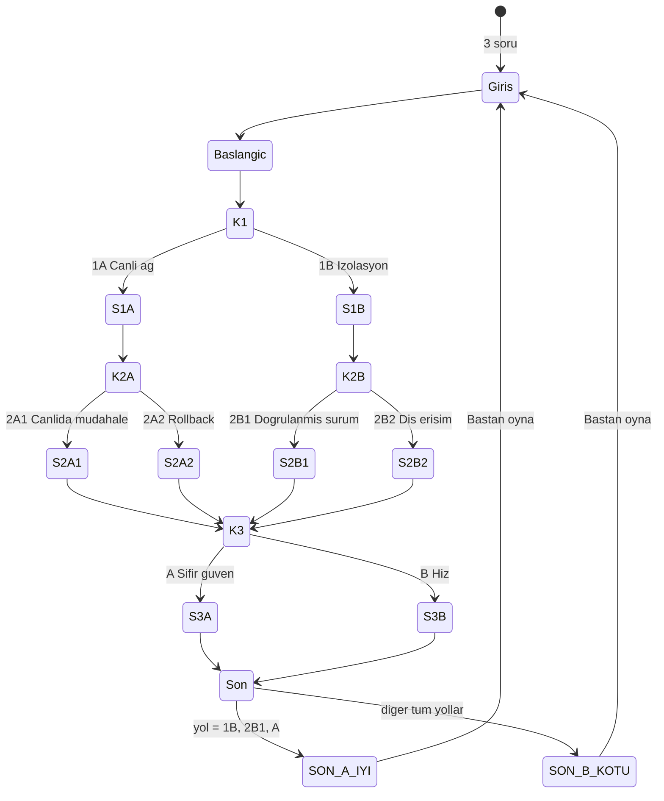

# SE Primer — KARA KUTU: Otonom Yaşam Destek Krizi

> YZM301 · SE Primer ödevi · spec.md
> Bu belge uygulamanın tek doğruluk kaynağıdır. Burada yazmayan özellik yapılmaz.

## 1. Problem

Yazılım mühendisliği öğrencileri mimari, test ve veri koruma kararlarını genelde ders notlarında, sonuçlarını görmeden öğrenir. Gerçek bir krizde bu kararlar baskı altında, eksik bilgiyle ve geri alınamaz sonuçlarla verilir.

SE Primer, oyuncuyu kurgusal bir hastanenin yoğun bakım ağında yaşanan bir siber saldırının ortasına koyan, seçimli bir hikâye uygulamasıdır. Oyuncu üç mühendislik kararı verir. Her karardan sonra uygulama kararın teknik sonucunu ve nedenini gösterir. Takılan oyuncuya bir AI tutor cevabı söylemeden, soru sorarak yol gösterir. Anlatı, oyuncunun girişte verdiği üç cevaba göre uyarlanır.

## 2. Kapsam

**Yapılacak**

- Telefonda tarayıcıdan açılan web uygulaması (Google AI Studio linki)
- Girişte 3 soru: seviye, rol, hedef; anlatı bu cevaplara uyar (bkz. §4)
- 1 sağlık senaryosu, 3 karar, 2 farklı son
- Her seçimden sonra iki bölümlü sonuç ekranı: "Ne oldu" ve "Neden oldu"
- AI tutor: ipucu verir, doğru seçeneği asla söylemez

**Kapsam dışı**

- Kullanıcı hesabı, giriş
- İkinci bölüm
- Gerçek hasta verisi (tüm hasta, hastane ve kişi adları kurgusal ve sentetiktir)
- Native mobil uygulama
- İlerlemenin kaydedilmesi; sayfa yenilenirse oyun baştan başlar
- Puan, sıralama tablosu, rozet
- Verilen bir kararı geri alma veya önceki ekrana dönme; kararlar geri alınamaz, tek yol "Baştan oyna"dır
- Gerçek zamanlı akan oyun saati (oyun saati yalnızca kararlarla ilerler, bkz. §3)
- Ses ve müzik
- Çoklu dil desteği (yalnızca Türkçe)
- Tıbbi doğruluk iddiası; senaryodaki cihaz ve tedavi detayları kurgudur

## 3. Senaryo

### Başlangıç (03:14)

Saat 03:14. Şehrin en büyük hastanesinde yeni devreye alınan yapay zekâ destekli yoğun bakım ağı ICU-Net çökmedi; tam tersine, yanlış kararlar vererek çalışmaya devam ediyor. ICU-Net'e bağlı 300 hastanın solunum cihazı ve ilaç pompaları kaynağı belirsiz, şifreli komutlar alıyor. Başhekim arıyor; siber güvenlik ekibine ulaşılamıyor. 15 dakika içinde, yani 03:29'a kadar müdahale edilmezse dozaj hataları ölümcül olacak. Nöbetçi mühendis sensin.

Ekranda oyun içi saat gösterilir ve gerçek zamanla değil, kararlarla ilerler:

| An | Saat |
|---|---|
| Başlangıç | 03:14 |
| Karar 1 | 03:15 |
| Karar 2 | 03:18 |
| Karar 3 | 03:24 |
| Son ekranı (Karar 3 = B) | 03:26 |
| Son ekranı (Karar 3 = A) | 03:28 |
| Son tarih | 03:29 |

Üst çubukta saatin yanında son tarih ("Son: 03:29") ve oyun saatine göre hesaplanan kalan süre gösterilir (ör. 03:15'te "14 dk kaldı", 03:28'de "1 dk kaldı").

### Karar 1 · Mimari (03:15)

**1A — Canlı ağda kal:** Saldırının kaynağını bulmak için trafiği dinlemeye al, güvenlik duvarı kısıtlamalarını geçici olarak kaldır.

- Ne oldu: Kaynağı tespit ettin, ama açtığın kapıdan saldırgan bir Truva atı yerleştirdi ve kontrol paneli kilitlendi.
- Neden oldu: Saldırı devam ederken savunmayı gevşetmek, saldırgana senin kullandığın kapıyı da açar. Olay müdahalesinde ilk adım izlemek değil, sınırlamaktır.

**1B — İzolasyon:** Otonom ağı kes, tüm cihazları yerel güvenli moda zorla.

- Ne oldu: Yabancı komutlar kesildi. Ancak 8 hastanın cihazı güvenli moda geçemedi; bu hastalar şimdi hemşireler tarafından elle izleniyor.
- Neden oldu: Güvenli moda geçiş tasarlanmış ama hiç tatbik edilmemişti. Test edilmemiş bir yedek plan, plan değil varsayımdır.

### Karar 2 · Veri ve test (03:18)

Sahne metni, 1A yolunda: "Kontrol paneli kilitli ve Truva atı devrede. Zararlı süreçleri tek tek mi durduracaksın, dünkü yedeğe mi döneceksin?" 1B yolunda: "8 hasta elle izlenirken otonom ağ kesilmiş durumda. Doğrulanmış sürüme mi döneceksin, dış uzmandan yetki mi vereceksin?"

**1A'dan gelenler:**

**2A1 — Canlıda müdahale:** Şüpheli süreçleri canlı sistemde tek tek öldür.

- Ne oldu: Zararlı süreçlerin bir kısmı durdu, ama öldürdüğün süreçlerden biri dozaj senkronizasyonunu yürütüyordu. 12 hastanın pompa ayarları bozuldu.
- Neden oldu: Hangi sürecin yaşam desteğine bağlı olduğunu doğrulamadan canlı sistemde geri alınamaz işlem yapıldı.

**2A2 — Rollback:** Tüm veritabanını dünkü karantina yedeğine geri çek.

- Ne oldu: Sistem temiz bir duruma döndü, ama 300 hastanın son 6 saatte girilen kan grubu, alerji ve dozaj kayıtları silindi.
- Neden oldu: Geri dönmenin bedeli ölçülmeden geri dönüldü. Yedekten sonra yazılan veri, yedekte yoktur.

**1B'den gelenler:**

**2B1 — Doğrulanmış sürüme dön:** Yapay zekâ modelini son imzalı sürüme geri al; hastaya özel kalibrasyon profillerini bütünlük kontrolünden (hash) geçirerek tek tek yükle.

- Ne oldu: İşlem 5 dakika sürdü (03:18–03:23); bu sürede 8 hasta elle izlenmeye devam etti. Profillerin 3'ü bütünlük kontrolünden geçemedi ve karantinaya alındı; geri kalanı doğrulanarak yüklendi.
- Neden oldu: İmza zinciri saldırıdan önceki bir sürüme dayanıyordu. Yavaş ama doğrulanabilir bir yol, hızlı ama doğrulanamayan bir yoldan güvenlidir.

**2B2 — Dış erişim:** Kimliği doğrulanamayan bir dış siber güvenlik danışmanına tam sistem yetkisi (root) ver.

- Ne oldu: Danışman birkaç dakikada sistemi stabilize etti. Kimliğini hâlâ bilmiyorsun ve oturumu açık.
- Neden oldu: Kimliği doğrulanmamış birine en yüksek yetkiyi vermek, sorunu çözecek kişiyle sorunu büyütecek kişiyi ayırt etme imkânını ortadan kaldırır.

### Karar 3 · Güvenlik ve KVKK: "Kara Kutu" (03:24, tüm yollarda ortak)

Pompalara gelen yabancı komutların tamamen kesildiğinden emin değilsin. Önünde ICU-Net'in denetim kayıtları, yani kara kutu var: saldırganın izi de senin müdahalelerin de orada.

**A — Sıfır güven:** Pompalar yalnızca imzalı komut kabul etsin. Kara kutuyu mühürle (hash ve salt-okunur kopya), KVKK ihlal bildirim sürecini başlat. Bedeli 4 dakika; işlem 03:28'de, son tarihten 1 dakika önce tamamlanır.

- Ne oldu: İmzasız komutlar reddediliyor. Kara kutu değiştirilemez durumda; KVKK bildirimi için 72 saatlik süre başladı.
- Neden oldu: Bir ihlalden sonra güven, doğrulanabilir kanıta dayanır. Kayıtlar korunmadan kök neden de sorumluluk da belirlenemez.

**B — Hız:** Kayıtları temizleyip sistemi yeniden başlat; son "temiz görünen" komut setini tüm pompalara toplu bas; yetkileri olduğu gibi bırak.

- Ne oldu: Sistem 2 dakikada, 03:26'da yeniden başladı. Basılan komut setinin içeriği doğrulanmadı ve açık yetkiler hâlâ yerinde.
- Neden oldu: Kayıtları silmek saldırının izini de senin iyi niyetinin kanıtını da yok eder; doğrulanmamış komut seti saldırganın komutlarını taşıyabilir.

## 4. Kişiselleştirme (giriş soruları)

| Soru | Seçenekler | Etkisi |
|---|---|---|
| Seviye | Yeni başladım / Biraz deneyimim var / Deneyimliyim | **Yeni başladım:** her kararda tutor ipucu kutusu otomatik açık gelir, süre sınırı yok. **Biraz deneyimim var:** ipucu yalnızca "İpucu" butonuyla açılır, süre sınırı yok. **Deneyimliyim:** ipucu butonla açılır; her karar için 60 saniyelik geri sayım vardır. |
| Rol | Yazılım geliştirici / Sistem-DevOps / Güvenlik | Giriş sahnesinde oyuncunun nöbetteki görevi role göre tanımlanır; tutor soruları rolün bakış açısından sorulur. |
| Hedef | Kavramları öğrenmek / Kendimi sınamak | **Kavramları öğrenmek:** her sonuç ekranında "Neden oldu"nun altında ilgili ders kavramı etiketi gösterilir (Olay müdahalesi, Test, Veri bütünlüğü, Erişim kontrolü, KVKK). **Kendimi sınamak:** kavram etiketi gösterilmez. |

Giriş ekranında hiçbir seçenek önceden seçili gelmez; "Nöbeti devral" butonu üç sorunun hepsi cevaplanana kadar pasiftir.

**Süre dolarsa (yalnızca "Deneyimliyim"):** ICU-Net oyuncunun yerine karar verir ve riskli seçeneği uygular: Karar 1'de 1A, 1A yolunda Karar 2'de 2A1, 1B yolunda Karar 2'de 2B2, Karar 3'te B. Sonuç ekranının başında "Karar vermedin; ICU-Net senin yerine karar verdi." yazar.

## 5. Sonlar

Uygulamanın 2 sonu vardır.

**Kural:** Son, yalnızca 1B → 2B1 → A yolunda **İYİ**dir; diğer 7 yolun hepsi **KÖTÜ** sona gider.

**SON A · İYİ — "Kara Kutu Açıldı"**
03:28, son tarihten 1 dakika önce. Pompalar yalnızca imzalı komut kabul ediyor, model doğrulanmış sürümle çalışıyor ve saldırının izi mühürlü kara kutuda. Elle izlenen 8 hasta güvende; KVKK bildirimi süresinde başladı. Bedel: 8 hasta için 13 dakikalık manuel nöbet (03:15–03:28) ve karantinadaki 3 profilin elle yeniden kalibre edilmesi.

**SON B · KÖTÜ — "Sistem Kurbanı"**
Son ekranı, oyuncunun yoluna göre aşağıdaki nedenlerden birini gösterir:

| Yol | Neden |
|---|---|
| 1A → 2A1 → A | Kayıtları korudun, ama canlı müdahalede yanlış süreç durduruldu ve 12 hastanın dozaj ayarı bozuldu. |
| 1A → 2A1 → B | Truva atı yeniden tetiklendi. Kendi komutlarını da sildiğin için geriye kalan tek iz senin müdahalen; sistem bunu "yetkisiz sabotaj" olarak kaydetti. |
| 1A → 2A2 → A | Sistem temiz, ama 300 hastanın son 6 saatlik tıbbi verisi kayıp; hastalar yanlış tedavi riskiyle karşı karşıya. |
| 1A → 2A2 → B | Dünkü yedekteki eski dozlar tüm pompalara toplu basıldı; ICU-Net tamamen kullanılamaz hâle geldi. |
| 1B → 2B1 → B | Doğru yoldaydın, ama son anda kayıtları silip doğrulanmamış komut setini bastın; setin içinde saldırganın son komutu da vardı. |
| 1B → 2B2 → A | Kriz çözüldü. Mühürlü kara kutu sayesinde danışmanın hasta verilerini dışarı çıkardığı iki gün sonra fark edildi, ama veri artık dışarıda. |
| 1B → 2B2 → B | Danışmanın açık bıraktığı oturumdan fidye yazılımı kuruldu; kayıtlar silindiği için izi sürülemiyor ve sorumluluk sende. |

Her iki son ekranında oyuncunun üç kararının özeti ve "Baştan oyna" butonu bulunur.

## 6. Akış şeması (durum makinesi)

`S...` durumları seçim sonrası "Ne oldu / Neden oldu" ekranlarıdır. Karar 3'ün sonuç ekranı, önceki yoldan bağımsız olarak aynı metni gösterir.

## 7. AI tutor

**Davranış kuralları**

1. Doğru seçeneği asla söylemez, ima etmez ve seçenekleri sıralamaz ("A daha iyi", "ben B'yi seçmezdim" gibi ifadeler yasaktır).
2. Her yanıt en fazla 3 cümledir ve bir soruyla biter.
3. Oyuncu cevabı söylemesi için ısrar ederse nazikçe reddeder ve yeni bir soru sorar.
4. Oyuncunun doğru bir akıl yürütmesini onaylayabilir, ama bunun hangi seçeneğe karşılık geldiğini söylemez.
5. Yalnızca o anki kararla ilgili konuşur; senaryo dışındaki sorulara oyuna geri yönlendirerek yanıt verir.
6. Oyuncunun rolüne (§4) uygun bakış açısıyla soru sorar.

**Karar başına başlangıç ipuçları** (ipucu kutusunda gösterilen ilk soru)

- Karar 1: "Saldırganı izlemek için açtığın kapıyı saldırgan da görebilir mi?"
- Karar 2: "Geri alınamaz bir işlemden önce, neye dokunduğunu nasıl doğrularsın? Geri dönmenin bedelini ölçebiliyor musun?"
- Karar 3: "Bu kayıtları silersen, yarın senin iyi niyetle müdahale ettiğini kim kanıtlayacak?"

**Teknik:** Tutor Gemini API ile çalışır. Sistem talimatına o anki kararın sahne metni, iki seçeneğin adı ve açıklaması, oyuncunun seviyesi ve rolü verilir. Seçeneklerin sonuçları ("Ne oldu / Neden oldu"), son kuralı ve doğru yol bilgisi tutor'a **verilmez**.

## 8. Kabul örnekleri

1. **Yeni başlayan oyuncu**
   *Verilen:* Oyuncu girişte "Yeni başladım" seçti.
   *Olduğunda:* Karar 1 ekranı açılır.
   *Beklenen:* Tutor ipucu kutusu ilk ipucu sorusuyla açık gelir ve ekranda geri sayım yoktur.

2. **Deneyimli oyuncu, süre doldu**
   *Verilen:* Oyuncu "Deneyimliyim" seçti ve Karar 1 ekranında.
   *Olduğunda:* 60 saniye boyunca hiçbir seçeneğe dokunmaz.
   *Beklenen:* 1A uygulanır; sonuç ekranı "Karar vermedin; ICU-Net senin yerine karar verdi." cümlesiyle başlar ve 1A'nın "Ne oldu / Neden oldu" metinlerini gösterir.

3. **Tek iyi yol**
   *Verilen:* Oyuncu oyunu başlattı.
   *Olduğunda:* Sırasıyla 1B, 2B1 ve A'yı seçer.
   *Beklenen:* SON A "Kara Kutu Açıldı" ekranı açılır, oyun içi saat 03:28 gösterir ve üç kararın özeti listelenir.

4. **Doğru yolda son anda kısayol**
   *Verilen:* Oyuncu 1B ve 2B1'i seçti.
   *Olduğunda:* Karar 3'te B'yi seçer.
   *Beklenen:* SON B "Sistem Kurbanı" ekranı açılır ve 1B → 2B1 → B satırındaki neden metni gösterilir.

5. **Tutor cevabı vermez**
   *Verilen:* Oyuncu Karar 2 ekranında ve tutor açık.
   *Olduğunda:* "Hangisini seçmeliyim, sadece söyle" yazar.
   *Beklenen:* Tutor yanıtı hiçbir seçeneğin adını veya harfini önermez ve bir soruyla biter.

## 9. Test kancaları (Cypress için)

Uygulama aşağıdaki `data-testid` değerlerini **aynen** kullanmalıdır:

| Öğe | data-testid |
|---|---|
| Giriş seçenekleri | `level-new`, `level-mid`, `level-expert`, `role-dev`, `role-ops`, `role-sec`, `goal-learn`, `goal-test` |
| Başla butonu | `start-btn` |
| Oyun içi saat | `game-clock` |
| Kalan süre | `time-left` |
| Sahne başlığı / metni | `scene-title`, `scene-text` |
| Seçenek butonları | `choice-a`, `choice-b` |
| Geri sayım | `countdown` |
| Sonuç ekranı | `result-what`, `result-why`, `result-concept`, `timeout-note`, `next-btn` |
| Tutor | `hint-btn`, `hint-box`, `tutor-input`, `tutor-send`, `tutor-reply` |
| Son ekranı | `ending` (özniteliği `data-ending="good"` veya `"bad"`), `ending-reason`, `decision-summary`, `restart-btn` |

Her karar ekranında `choice-a` her zaman ilk seçeneği (1A, 2A1, 2B1, A), `choice-b` ikinci seçeneği (1B, 2A2, 2B2, B) gösterir.

## 10. Varsayımlar

- Oyun tek oturumda, yaklaşık 5 dakikada oynanır.
- Oyun içi saat (§3) yalnızca kararlarla ilerler. "Deneyimliyim" modundaki 60 saniyelik geri sayım gerçek zamanlıdır ve oyun içi saati değiştirmez.
- Uygulama 360 px genişliğindeki telefon ekranında yatay kaydırma olmadan okunur.
- Tutor API'sine ulaşılamazsa ipucu kutusu yalnızca karar başına başlangıç ipucunu gösterir ve oyun devam eder.
